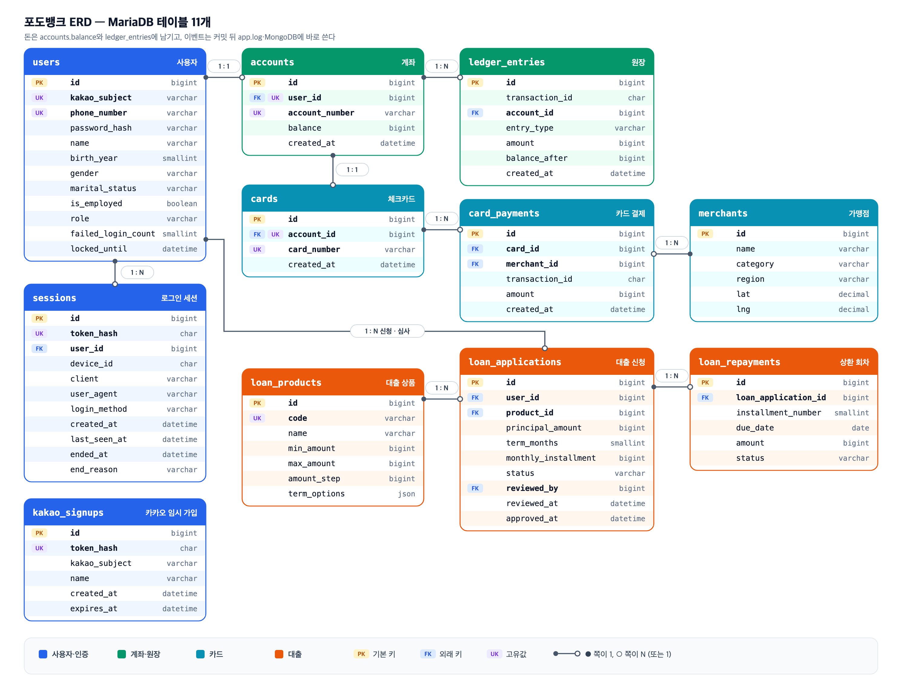

# 포도 뱅킹 시스템의 데이터 수집 & 관찰

---

> **뱅킹 서비스에서 발생하는 거래·이벤트·로그·메트릭을 수집하고, 데이터의 품질과 활용 가능성을 검증하는 프로젝트**
>
> 뱅킹 서비스를 직접 설계하면서 **데이터 발생 → 수집 → 저장 → 검증 → 관측**을 구현하는 프로젝트입니다.

📖 상세 문서는 [Wiki](https://github.com/encore-ai-campus/mlo-03-p1-team3/wiki)에 있습니다. (ERD 상세 · 아키텍처 · 저장 과정 · 사용자 흐름 · 보안 · 데이터 품질)

# 1. 팀 소개

**팀명: 개주인과 퍼피**

| 목원주 | 박기령 | 이하영 | 조경호 |
|---|---|---|---|
|  |  |  |  |
| [@wonju0516](https://github.com/wonju0516) | [@wrtmm](https://github.com/wrtmm) | [@coffeewoouuu](https://github.com/coffeewoouuu) | [@naelonambul](https://github.com/naelonambul) |

# 2. 프로젝트 개요

### 프로젝트명
PodoBank (포도뱅크)

### 프로젝트 소개
은행 시스템을 모의 구현해 데이터 발생 환경을 만들고, 데이터를 수집·검증·관측할 수 있는 환경을 구축합니다.
금융 거래가 정확하게 처리되고, 장애가 발생해도 거래 기록이 유실되지 않는 환경을 목표로 합니다.

### 프로젝트 목표

**1) 뱅킹 서비스 구현·배포**

- 회원, 입출금, 송금, 카드, 대출 기능을 갖춘 뱅킹 서비스

**2) 데이터 수집**

| 원천 | 저장 위치 | 수집 내용 |
| --- | --- | --- |
| 업무 데이터 | MariaDB (master / replica) | 회원, 계좌, 거래 원장, 카드 결제, 대출 |
| 사용자 행동·금융 이벤트 | MongoDB | 로그인, 송금, 카드 결제, 대출 신청 등 이벤트 |
| Nginx / HAProxy / FastAPI 로그 | Loki | 요청, 응답, 오류 로그 |
| 서버·애플리케이션 메트릭 | Prometheus | CPU, 메모리, 응답 시간, 요청 수 |

**3) 데이터 품질 검증 · 시각화**

- 누락, 중복, 정합성 확인 · Grafana 대시보드로 현황 모니터링

# 3. 기술 스택

| 프론트엔드 | 백엔드 | DB | 인프라 | 모니터링 | 테스트 |
| --- | --- | --- | --- | --- | --- |
|    |      |   |      |     |    |

# 4. 요구사항 명세서

| 기능 | 주요 내용 |
|---|---|
| 회원 관리 | 회원가입, 로그인(전화번호·카카오), 로그아웃 |
| 입출금 | 계좌 조회, 입금·출금, 거래 내역 조회 |
| 송금 | 수취인 조회, 계좌 간 송금 |
| 카드 | 체크카드 조회, 가맹점 결제 |
| 대출 | 상품 조회, 대출 신청, 직원 승인·거절, 상환 |

# 5. ERD



테이블별 속성은 [Wiki · ERD](https://github.com/encore-ai-campus/mlo-03-p1-team3/wiki/ERD)에 있습니다.

# 6. 주요 프로시저


```text
브라우저 → Nginx → HAProxy → FastAPI 1 / FastAPI 2 → MariaDB master → replica
                                                  └→ MongoDB (이벤트)
Nginx·HAProxy·FastAPI 로그 → Alloy → Loki → Grafana
서버·서비스 지표 → Prometheus → Grafana
```

- 구성요소 설명: [Wiki · 아키텍처](https://github.com/encore-ai-campus/mlo-03-p1-team3/wiki/Architecture)
- 데이터가 저장되는 과정: [MariaDB](https://github.com/encore-ai-campus/mlo-03-p1-team3/wiki/MariaDB-Storage-Flow) · [MongoDB](https://github.com/encore-ai-campus/mlo-03-p1-team3/wiki/MongoDB-Storage-Flow)
- 실제 사용자 흐름: [Wiki · 사용자 흐름](https://github.com/encore-ai-campus/mlo-03-p1-team3/wiki/User-Flow)
- 구성요소별 보안: [Wiki · 보안](https://github.com/encore-ai-campus/mlo-03-p1-team3/wiki/Security)

# 7. 수행결과(테스트/시연 페이지)

- ### 서비스 이용 자동화


Playwright로 가상 사용자(페르소나)가 실제 브라우저에서 서비스를 이용하도록 자동화. 가입·로그인·입금·송금·카드 결제·대출 신청이 화면에서 실행되어 MariaDB와 MongoDB에 데이터가 쌓입니다. 전체 화면은 [사용자 매뉴얼](docs/user-manual.md)을 참고하세요.

- ### 초당 RPS


Nginx 서버 모니터링 화면. 동시 접속자 200명이 요청을 보내 HTTP 요청률이 약 78 RPS에서 약 200 RPS까지 올라 유지되는 모습. 부하 전체 구간(약 2분 30초) 동안 총 29,103건을 처리했고 실패는 0건, p95 응답 시간은 150ms.

- ### 이벤트 로그 데이터 적재


MongoDB 화면. 사용자 행동·금융 이벤트가 문서(JSON)로 저장되는 모습. 이벤트는 MariaDB 커밋이 성공한 뒤에만 기록하고, `event_id` 고유 인덱스로 중복을 막습니다.

- ### 데이터 품질 검증
  - **정확성**: 돈이 움직이는 요청은 한 트랜잭션으로 처리하고, 계좌 행을 `FOR UPDATE`로 잠근 뒤 계산합니다. 송금은 계좌 ID가 작은 쪽부터 잠가 교착을 막습니다.
  - **정합성**: 일 마감 대사 배치가 계좌별 원장 합계와 잔액을 비교하고, 외래키·`CHECK` 제약으로 잘못된 값을 거부합니다.
  - **유일성**: 전화번호·계좌번호·카드번호 등에 `UNIQUE`를 두고, MongoDB 이벤트는 `event_id`에 고유 인덱스를 둡니다.
  - **완전성·일관성**: 이벤트는 커밋된 뒤에만 기록하고, 필드를 고정해 개인정보 키를 차단합니다.

  자세한 방법과 근거는 [Wiki · 데이터 품질](https://github.com/encore-ai-campus/mlo-03-p1-team3/wiki/Data-Quality)에 있습니다.
