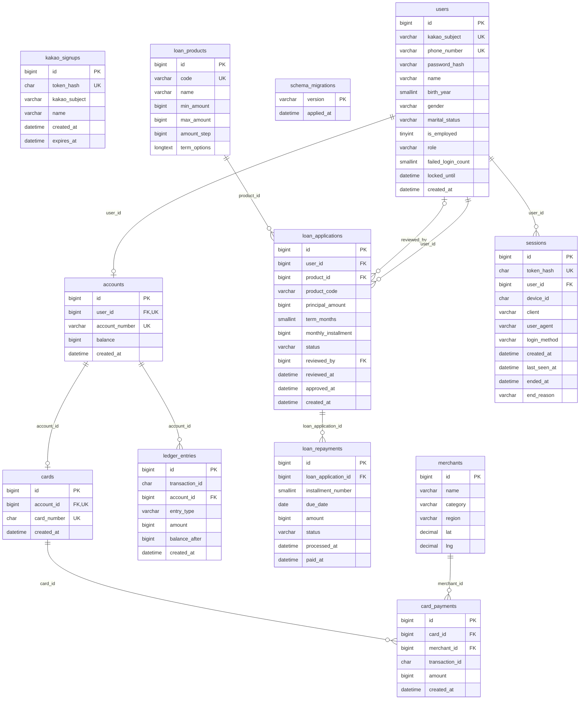
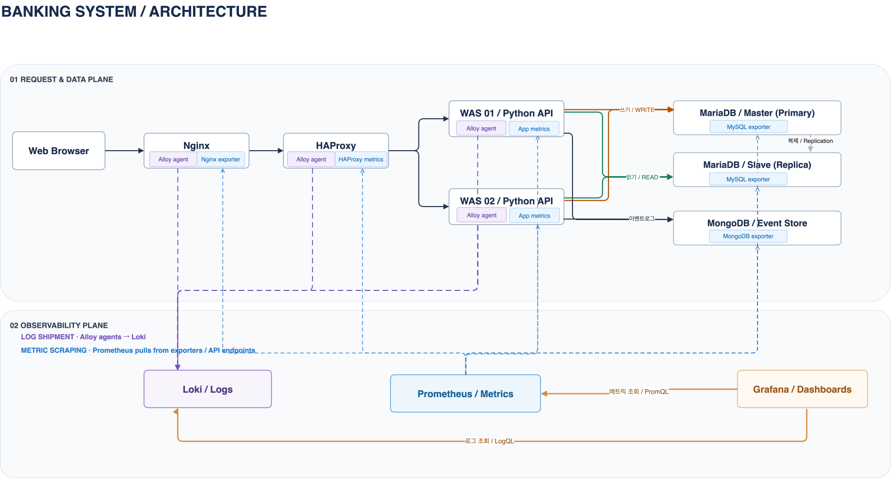
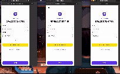
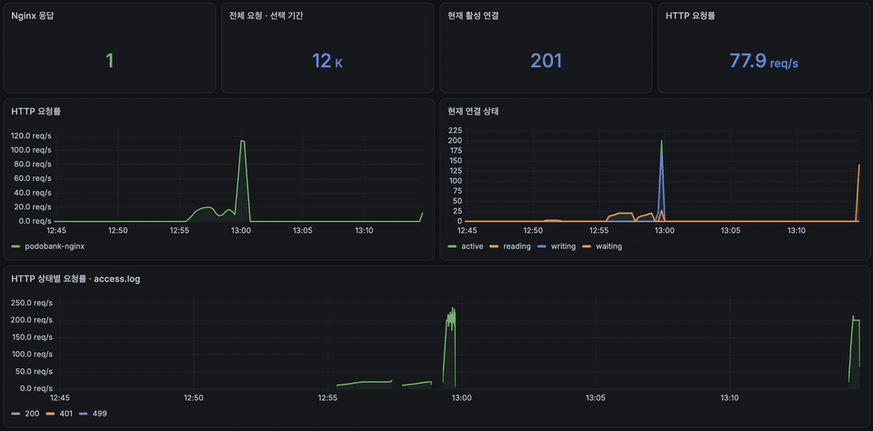
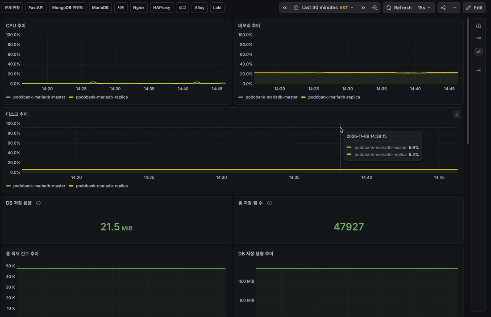
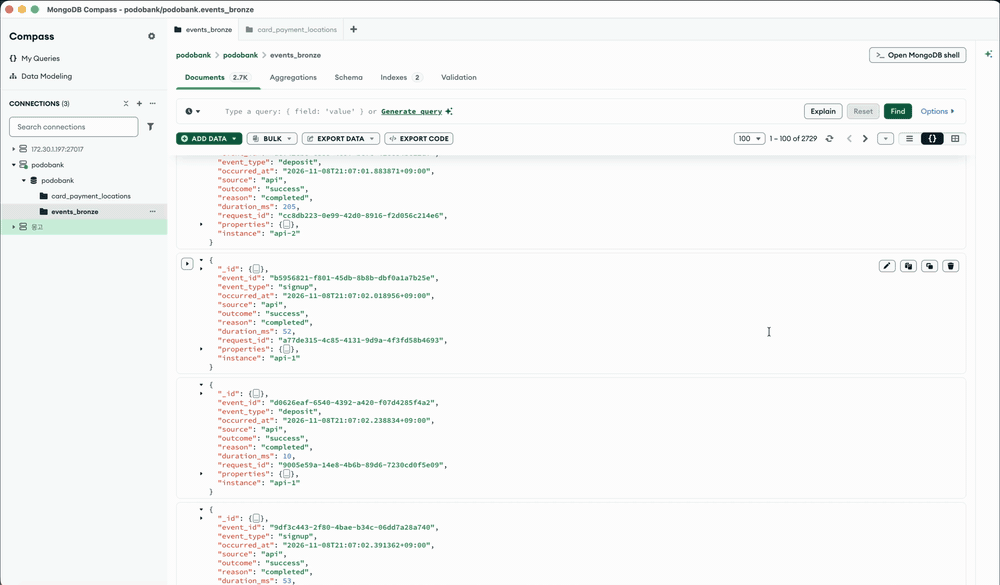

# 포도 뱅킹 시스템의 데이터 수집 & 관찰

---

> **뱅킹 서비스에서 발생하는 거래·이벤트·로그·메트릭을 수집하고, 데이터의 품질과 활용 가능성을 검증하는 프로젝트**
>
> 뱅킹 서비스를 직접 설계하면서 **데이터 발생 → 수집 → 저장 → 검증 → 관측**을 구현하는 프로젝트입니다.

📖 상세 문서: [Wiki](https://github.com/encore-ai-campus/mlo-03-p1-team3/wiki)

# 1. 팀 소개

**팀명: 개주인과 퍼피**

| 목원주 | 박기령 | 이하영 | 조경호 |
|---|---|---|---|
|  |  |  |  |
| [@wonju0516](https://github.com/wonju0516) | [@wrtmm](https://github.com/wrtmm) | [@coffeewoouuu](https://github.com/coffeewoouuu) | [@naelonambul](https://github.com/naelonambul) |

# 2. 프로젝트 개요

### 프로젝트명
PodoBank (포도뱅크)

### 프로젝트 소개
은행 시스템을 모의 구현해 데이터 발생 환경을 만들고, 데이터를 수집·검증·관측할 수 있는 환경을 구축합니다.
금융 거래가 정확하게 처리되고, 장애가 발생해도 거래 기록이 유실되지 않는 환경을 목표로 합니다.

### 프로젝트 목표

**1) 뱅킹 서비스 구현·배포**

- 회원, 입출금, 송금, 카드, 대출 기능을 갖춘 뱅킹 서비스

**2) 데이터 수집**

| 원천 | 저장 위치 | 수집 내용 |
| --- | --- | --- |
| 업무 데이터 | MariaDB (master / replica) | 회원, 계좌, 거래 원장, 카드 결제, 대출 |
| 사용자 행동·금융 이벤트 | MongoDB | 로그인, 송금, 카드 결제, 대출 신청 등 이벤트 |
| Nginx / HAProxy / FastAPI 로그 | Loki | 요청, 응답, 오류 로그 |
| 서버·애플리케이션 메트릭 | Prometheus | CPU, 메모리, 응답 시간, 요청 수 |

**3) 데이터 품질 검증 · 시각화**

- 누락, 중복, 정합성 확인 · Grafana 대시보드로 현황 모니터링

# 3. 기술 스택

| 프론트엔드 | 백엔드 | DB | 테스트 | 데이터 수집 |
| --- | --- | --- | --- | --- |
|   |      |   |   |      |

# 4. 요구사항 명세서

| 기능 | 주요 내용 |
|---|---|
| 회원 관리 | 회원가입, 로그인(전화번호·카카오), 로그아웃 |
| 입출금 | 계좌 조회, 입금·출금, 거래 내역 조회 |
| 송금 | 수취인 조회, 계좌 간 송금 |
| 카드 | 체크카드 조회, 가맹점 결제 |
| 대출 | 상품 조회, 대출 신청, 직원 승인·거절, 상환 |

# 5. ERD

테이블별 속성은 [Wiki · ERD](https://github.com/encore-ai-campus/mlo-03-p1-team3/wiki/ERD)에 있습니다.

# 6. 주요 프로시저

상세 설명: [Wiki · 주요 프로시저](https://github.com/encore-ai-campus/mlo-03-p1-team3/wiki/%EC%A3%BC%EC%9A%94-%ED%94%84%EB%A1%9C%EC%8B%9C%EC%A0%80)

# 7. 수행결과(테스트/시연 페이지)

- ### 서비스 이용 자동화

Playwright로 가상 고객(페르소나)이 실제 브라우저에서 서비스를 이용하도록 자동화. 가입·로그인·입금·송금·카드 결제·대출 신청이 화면에서 실행되어 MariaDB와 MongoDB에 데이터가 쌓입니다.

- ### 초당 RPS

Nginx 서버 모니터링 화면. 동시 접속자 200명이 요청을 보내 HTTP 요청률이 약 78 RPS에서 약 200 RPS까지 올라 유지되는 모습. 부하 전체 구간(약 2분 30초) 동안 총 29,103건을 처리했고 실패는 0건, p95 응답 시간은 150ms.

- ### 부하 테스트
Locust로 실제 VM 환경(Nginx → HAProxy → FastAPI 2대 → MariaDB·MongoDB)에 직접 부하를 걸어 검증했습니다.

**읽기(조회)**: 로그인한 사용자가 계좌·거래내역·내 정보를 조회

| 동시 접속자 | 처리량 | 총 요청 | 실패 | p95 |
|---:|---:|---:|---:|---:|
| 200명 | 약 200 RPS | 29,103건 | 0건 | 150ms |

**쓰기(송금)**: 잔액 조회 → 받는 사람 조회 → 송금 → 잔액 조회 (송금 1건 = HTTP 요청 4개), 준비 계정 1,000개, 단계별 60초

| 목표 송금/초 | 실제 송금/초 | HTTP 요청 | 실패 | p95 | 판정 |
|---:|---:|---:|---:|---:|---|
| 80 | 80 | 19,200 | 0 | 72ms | 통과 |
| 160 | 160 | 38,400 | 0 | 130ms | 통과 |

시험 후 MariaDB master·replica의 계좌·원장 수가 일치했고, 잔액-원장 불일치·깨진 송금 쌍·음수 잔액은 0건이었습니다. 자세한 조건과 재실행 명령: [운영 현황 문서](docs/OPERATIONS_HANDOFF.md)

- ### 정형 데이터 적재

MariaDB 서버 모니터링 화면. 서비스 이용에 따라 회원·계좌·세션·원장·카드 결제·대출 테이블의 총 저장 행 수가 47,927건에서 48,013건으로 계속 늘어나는 모습.

- ### 이벤트 로그 데이터 적재

MongoDB Compass 화면. `events_bronze` 컬렉션에 사용자 행동·금융 이벤트가 문서(JSON)로 저장되는 모습. 이벤트는 MariaDB 커밋이 성공한 뒤에만 기록하고, `event_id` 고유 인덱스로 중복을 막습니다.
