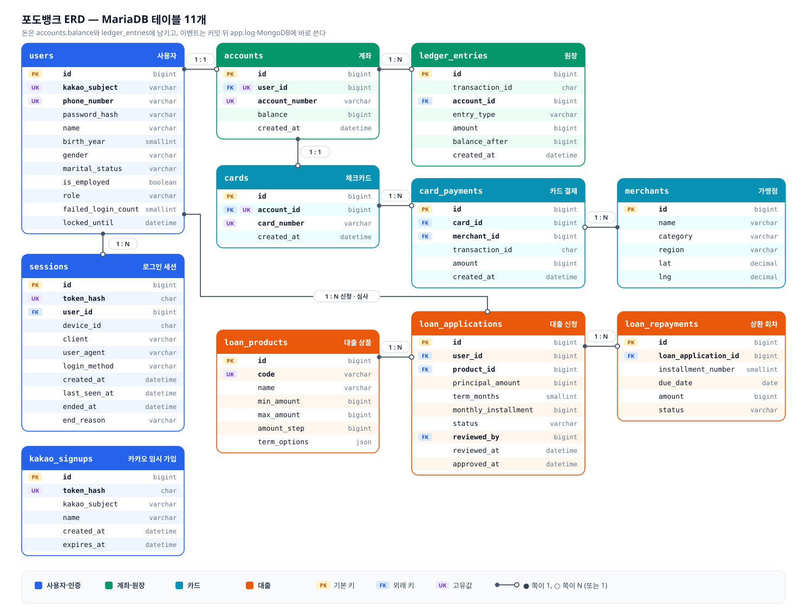
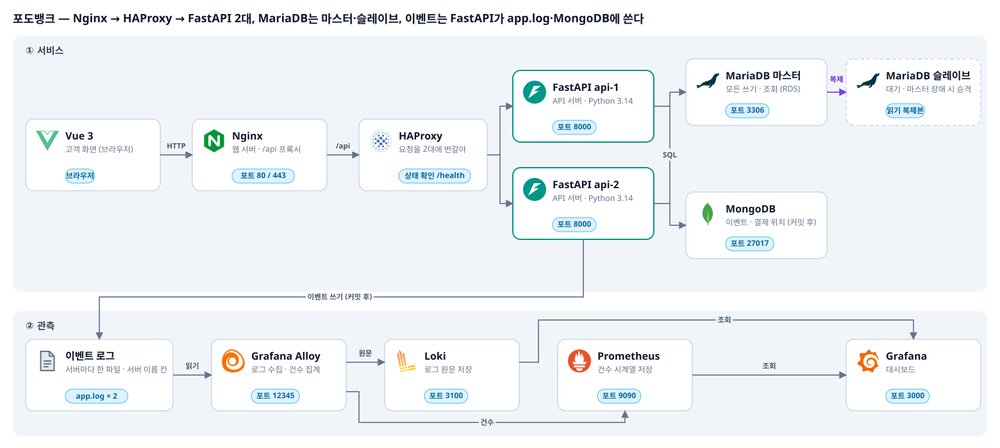
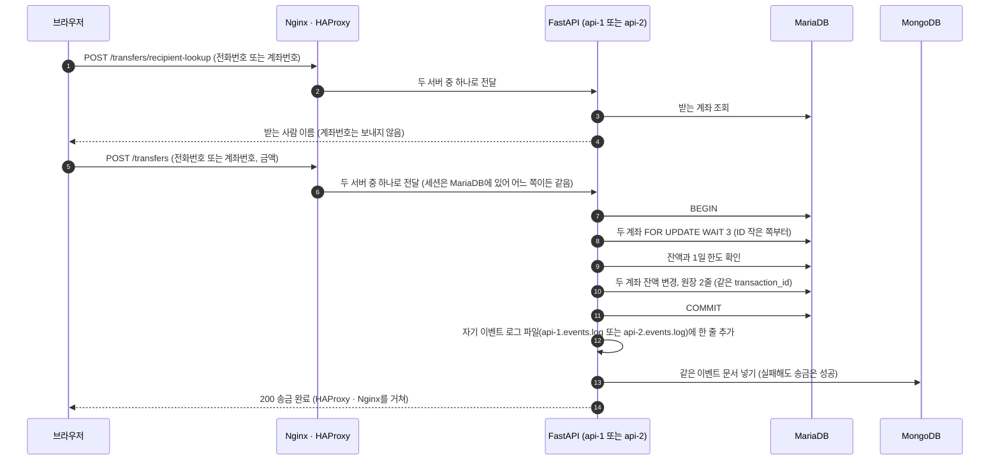
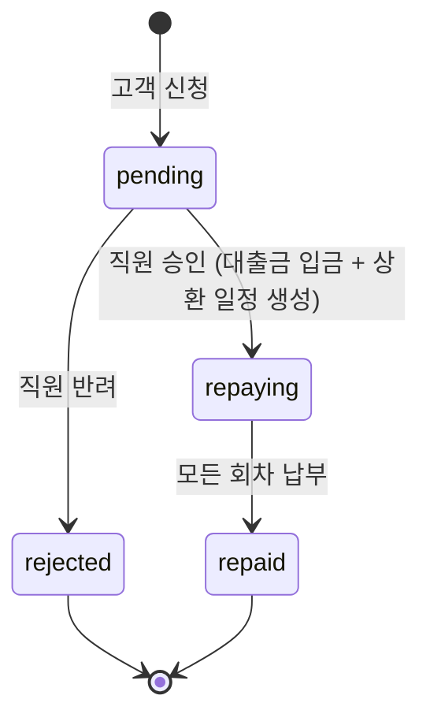
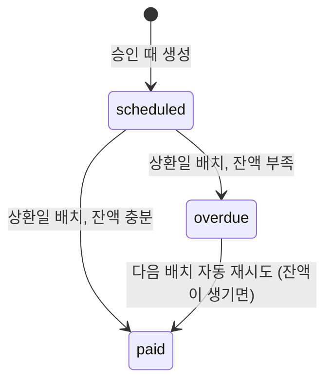

# mlo-03-p1-team3

## 1. 팀 소개

### 개주인과 퍼피

### 팀원 소개

| 이름 | 역할 | GitHub |
|------|------|--------|
| 목원주 |  | [wonju0516](https://github.com/wonju0516) |
| 박기령 |  | [wrtmm](https://github.com/wrtmm) |
| 이하영 |  | [coffeewoouuu](https://github.com/coffeewoouuu) |
| 조경호 |  | [naelonambul](https://github.com/naelonambul) |

## 2. 프로젝트 개요

### 프로젝트명
포도뱅크 (PodoBank)

### 프로젝트 소개
가입 · 입출금 · 송금 · 체크카드 · 대출을 처리하는 가상 은행 서비스의 백엔드입니다. 실제 은행 앱처럼 돈의 정합성, 동시성, 권한, 장애를 고려해서 운영하고, 최종 목적은 서비스에서 생기는 데이터를 파이프라인으로 모아 **유의미한 데이터를 쌓는 것**입니다.

### 프로젝트 필요성
실제 은행 서비스처럼 가입 · 로그인 · 송금 · 결제 · 대출이 일어나야, 데이터 파이프라인과 대시보드에 쓸 수 있는 현실적인 데이터가 생깁니다. 그래서 돈이 틀리지 않게 운영되는 은행 백엔드와, 그 안에서 생기는 이벤트를 개인정보 없이 쌓는 구조를 함께 만듭니다.

### 프로젝트 목표
- 실제 은행 앱처럼 돈의 정합성, 동시성, 권한, 장애를 고려해서 운영합니다.
- 서비스에서 생기는 이벤트를 데이터 파이프라인으로 모아 유의미한 데이터를 쌓습니다.

---

## 3. 기술 스택

| 영역 | 기술 |
|---|---|
| 프론트엔드 | Vue 3, Pinia, Vite |
| 웹 서버 · 로드밸런서 | Nginx, HAProxy |
| 백엔드 | FastAPI (Python 3.14), SQLAlchemy Core + 직접 쓴 SQL |
| 정형 데이터 | MariaDB 11.4 (계좌 · 원장 · 대출 · 카드 · 세션) |
| 비정형 데이터 | MongoDB 7 (이벤트 · 결제 위치) |
| 관측 | 이벤트 로그 → Grafana Alloy → Loki · Prometheus → Grafana |
| 테스트 | pytest (실제 MariaDB · MongoDB) |
| 인프라 | Terraform (노트북 한 대에서 먼저, 이후 AWS) |

---

## 4. WBS

| 작업 코드 | 작업 항목 | 주요 내용 | 담당자 | 상태 |
|---|---|---|---|---|
| WBS-01 | 요구사항 정의 | 서비스 기능 및 데이터 수집 대상 선정 | 미정 | 예정 |
| WBS-02 | 아키텍처 설계 | AWS 인프라, 네트워크, DB 다중화 구조 설계 | 미정 | 예정 |
| WBS-03 | 인프라 구축 | Nginx, HAProxy, WAS, MariaDB, MongoDB 구축 | 미정 | 예정 |
| WBS-04 | 뱅킹 서비스 개발 | 회원, 계좌, 입출금, 송금, 카드, 대출 기능 구현 | 미정 | 예정 |
| WBS-05 | 데이터 발생 환경 구축 | 거래 이벤트 설계 및 Playwright 테스트 자동화 | 미정 | 예정 |
| WBS-06 | 데이터 수집 파이프라인 구축 | Alloy, Prometheus, Loki 기반 로그·메트릭 수집 | 미정 | 예정 |
| WBS-07 | 데이터 검증 | 수집 누락, 데이터 정합성, 수집 지연 확인 | 미정 | 예정 |
| WBS-08 | 데이터 시각화 | Grafana 대시보드 구축 및 주요 지표 시각화 | 미정 | 예정 |
| WBS-09 | 통합 테스트 및 문서화 | 전체 흐름 검증, 결과 분석 및 문서 정리 | 미정 | 예정 |

---

## 5. 요구사항 명세서

### 5.1 기능 요구사항

| ID | 영역 | 요구사항 | API |
|---|---|---|---|
| FR-01 | 회원 | 이름 · 전화번호 · 비밀번호 · 출생 연도 · 성별 · 혼인 상태 · 직장 유무로 가입하고, 가입하면 바로 로그인된다 | `POST /auth/signup` |
| FR-02 | 회원 | 카카오로 본인을 확인한 뒤 전화번호 · 비밀번호 등을 정해 가입한다(이름은 카카오 프로필) | `POST /auth/kakao/start`, `/kakao/login`, `/kakao/signup` |
| FR-03 | 회원 | 전화번호 + 비밀번호로 로그인한다(카카오 가입 고객 포함) | `POST /auth/login` |
| FR-04 | 회원 | 가입한 카카오 계정으로 바로 로그인한다 | `POST /auth/kakao/login` |
| FR-05 | 회원 | 로그아웃하면 서버에서 세션이 끝난다 | `POST /auth/logout` |
| FR-06 | 회원 | 내 이름과 역할을 조회한다 | `GET /auth/me` |
| FR-07 | 회원 | 비밀번호를 5번 틀리면 5분 동안 로그인(카카오 포함)이 막힌다 | `POST /auth/login` |
| FR-08 | 회원 | 세션은 미사용 10분 · 최대 60분에 끝나고, 기기 · 채널(`web` / `ios-app` / `android-app`)별로 기록된다 | 모든 API |
| FR-09 | 계좌 | 가입하면 계좌 1개와 체크카드 1장이 자동으로 만들어진다 | `POST /auth/signup`, `/kakao/signup` |
| FR-10 | 계좌 | 내 계좌번호와 잔액을 조회한다 | `GET /accounts/me` |
| FR-11 | 계좌 | 거래 내역을 최근 것부터 나눠서(1~100건) 조회한다 | `GET /accounts/me/ledger` |
| FR-12 | 입출금 | 1회 1원 ~ 1,000만 원을 입금 · 출금한다. 잔액보다 많이 출금할 수 없다 | `POST /transactions/deposit`, `/withdrawal` |
| FR-13 | 송금 | 전화번호 또는 계좌번호로 받는 사람 이름을 확인한다(계좌번호는 돌려주지 않음) | `POST /transfers/recipient-lookup` |
| FR-14 | 송금 | 1회 1,000만 원, 하루(한국 시간) 1억 원까지 수수료 없이 송금한다. 내 계좌로는 보낼 수 없다 | `POST /transfers` |
| FR-15 | 카드 | 내 카드 끝 4자리와 가맹점 목록을 조회한다 | `GET /cards/me`, `GET /merchants` |
| FR-16 | 카드 | 가맹점을 골라 1회 1,000만 원까지 결제하면 계좌에서 바로 빠진다 | `POST /cards/payments` |
| FR-17 | 대출 | 대출 상품(자동차 · 전세 · 주택)의 한도와 기간을 조회한다 | `GET /loans/products` |
| FR-18 | 대출 | 금액(100만 원 단위)과 기간을 골라 신청한다. 진행 중인 대출은 1인 1건이다 | `POST /loans/applications` |
| FR-19 | 대출 | 내 대출과 회차별 상환 일정 · 상태를 조회한다 | `GET /loans/me` |
| FR-20 | 대출 | 직원이 심사 대기 목록을 보고 승인 · 반려한다. 승인하면 대출금이 입금되고 상환 회차가 만들어진다 | `GET /admin/loans/pending`, `POST /admin/loans/{id}/approve`, `/reject` |
| FR-21 | 대출 | 상환일에 배치가 회차 금액을 계좌에서 빼 간다. 잔액이 모자라면 연체가 되고 다음 배치가 다시 시도한다 | 배치 |
| FR-22 | 운영 | 하루 마감 때 계좌마다 원장 합계와 잔액이 같은지 대사한다 | 배치 |
| FR-23 | 관측 | 금융 · 인증 이벤트를 커밋 뒤 이벤트 로그 파일과 MongoDB에 한 번씩 남긴다 | 모든 금융 · 인증 API |

이자는 없습니다. 월 상환액은 원금 ÷ 개월 수이고, 마지막 회차가 남은 원을 더 냅니다.

### 5.2 비기능 요구사항

| ID | 항목 | 요구사항 |
|---|---|---|
| NFR-01 | 정합성 | 잔액은 음수가 될 수 없고, 계좌마다 원장 합계 = 잔액이다. 송금은 출금 · 입금 원장 두 줄을 같은 `transaction_id`로 묶는다 |
| NFR-02 | 동시성 | 같은 계좌를 동시에 건드리면 행 잠금으로 차례대로 처리한다. 두 계좌는 ID가 작은 쪽부터 잠그고, 잠금은 3초까지 기다린다(초과 시 409). 교착이면 한 번 다시 시도한다 |
| NFR-03 | 보안 | 비밀번호는 Argon2id 해시, 세션 값은 SHA-256 해시로만 저장한다. 쿠키는 HttpOnly · SameSite=Lax. 고객은 직원 API를, 직원은 고객 API를 쓸 수 없다(403) |
| NFR-04 | 개인정보 | 이벤트에는 사용자 ID, 이름, 전화번호, 계좌 · 카드번호, 정확한 금액, 프로필 값을 넣지 않는다(금액은 구간) |
| NFR-05 | 장애 | MongoDB나 로그 파일이 실패해도 금융 작업은 성공한다. FastAPI 1대가 죽으면 HAProxy가 남은 서버로 보낸다. MariaDB 장애는 503으로 알린다 |
| NFR-06 | 배포 | 배포할 때 HTTPS를 쓰고 쿠키 `Secure`를 켠다 |

---

## 6. ERD (MariaDB)



### 테이블 관계

| 관계 | 뜻 |
|---|---|
| users 1 : N sessions | 한 사람이 여러 기기·여러 번 로그인 |
| users 1 : 1 accounts | 고객 1명당 계좌 1개 |
| accounts 1 : 1 cards | 계좌 1개당 카드 1장 |
| accounts 1 : N ledger_entries | 계좌 하나에 거래 기록 여러 줄 |
| cards 1 : N card_payments | 카드 하나로 결제 여러 번 |
| merchants 1 : N card_payments | 가게 하나에서 결제 여러 번 |
| users 1 : N loan_applications | 고객 한 명이 대출을 여러 번 신청(진행 중은 1건만) |
| loan_products 1 : N loan_applications | 상품 하나에 신청 여러 건 |
| loan_applications 1 : N loan_repayments | 대출 하나에 회차 여러 개 |

### 제약과 인덱스

| 테이블 | 제약·인덱스 | 막는 실패 |
|---|---|---|
| users | `kakao_subject` UNIQUE, `phone_number` UNIQUE, `password_hash` NOT NULL, `birth_year`·`gender`·`role` CHECK | 동시 가입 중복, 이상한 값 |
| sessions | `token_hash` UNIQUE, `(user_id, device_id, ended_at)` 인덱스, `client`·`login_method`·`end_reason` CHECK | 세션 값 중복, 같은 기기 세션 찾기, 이상한 값 |
| kakao_signups | `token_hash` UNIQUE | 임시 가입 값 중복 |
| accounts | `user_id` UNIQUE, `account_number` UNIQUE, `balance >= 0` CHECK | 1인 2계좌, 잔액 음수 |
| cards | `account_id` UNIQUE, `card_number` UNIQUE | 계좌당 카드 2장 |
| ledger_entries | `(account_id, created_at)` 인덱스, `balance_after >= 0` CHECK | 1일 한도 합계, 거래 내역 조회 |
| loan_applications | `(user_id, status)`, `(status, id)` 인덱스 | 진행 중 대출 확인, 심사 대기 목록 |
| loan_repayments | `(loan_application_id, installment_number)` UNIQUE, `(status, due_date)` 인덱스 | 회차 중복, 상환 배치 조회 |

- "1인 1진행 대출"은 MariaDB에서 조건부 UNIQUE를 걸 수 없어서, 고객 계좌 행을 잠근 뒤 진행 중 대출을 확인해서 막습니다.
- 대출 이자는 없습니다. 회차 금액(`amount`)은 원금 ÷ 개월 수입니다.

### 컬럼 설명

금액은 모두 원 단위 정수이고, 시각은 모두 UTC로 저장합니다(한국 시간 = UTC + 9시간). 키: PK = 기본 키, FK = 다른 테이블을 가리킴, UK = 중복 불가.

<details>
<summary><b>users</b> — 사용자</summary>

고객과 은행 직원이 함께 들어 있습니다. `role`로 구분합니다.

| 컬럼 | 한글 이름 | 타입 | 키 | 빈 값 | 설명 | 예시 |
|---|---|---|---|---|---|---|
| `id` | 사용자 번호 | bigint | PK | | | 1 |
| `kakao_subject` | 카카오 회원 번호 | varchar(64) | UK | 가능 | 카카오가 주는 사용자 고유 번호. 카카오로 가입한 고객만 있고, 일반 가입 고객과 직원은 비어 있음 | `"3456789012"` |
| `phone_number` | 전화번호 | varchar(15) | UK | | 로그인 아이디. 숫자만 저장 | `"01012345678"` |
| `password_hash` | 비밀번호 해시 | varchar(255) | | | 비밀번호를 Argon2id로 바꾼 값. 원래 비밀번호는 저장하지 않음 | `"$argon2id$..."` |
| `name` | 이름 | varchar(50) | | | 일반 가입은 가입 화면에서 입력한 이름, 카카오 가입은 카카오 프로필 이름. 송금 받는 사람 조회에서 보여 줌 | `"홍길동"` |
| `birth_year` | 출생 연도 | smallint | | | 1900 이상 | 1995 |
| `gender` | 성별 | varchar(10) | | | `male` / `female` | `"female"` |
| `marital_status` | 혼인 상태 | varchar(10) | | | `single`(미혼) / `married`(기혼) | `"single"` |
| `is_employed` | 직장 유무 | boolean | | | 직장이 있으면 1. 직원이 대출을 심사할 때 봄 | 1 |
| `role` | 역할 | varchar(20) | | | `customer`(고객) / `bank_employee`(직원). 기본값 `customer` | `"customer"` |
| `failed_login_count` | 로그인 실패 횟수 | smallint | | | 비밀번호를 연속으로 틀린 횟수. 로그인에 성공하면 0으로 돌아감 | 2 |
| `locked_until` | 잠금 해제 시각 | datetime | | 가능 | 5번 틀리면 이 시각까지 로그인이 막힘. 잠겨 있지 않으면 비어 있음 | `2026-11-04 05:15:00` |
| `created_at` | 가입 시각 | datetime | | | | |

</details>

<details>
<summary><b>sessions</b> — 로그인 세션</summary>

로그인(로컬·카카오)이나 가입을 하면 한 줄 생깁니다. 쿠키에는 세션 값 원본, 여기에는 그 해시만 둡니다. 끝난 세션도 지우지 않습니다.

| 컬럼 | 한글 이름 | 타입 | 키 | 빈 값 | 설명 | 예시 |
|---|---|---|---|---|---|---|
| `id` | 세션 번호(내부) | bigint | PK | | | 1 |
| `token_hash` | 세션 값 해시 | char(64) | UK | | 쿠키 `podobank_session` 값의 SHA-256. 원본은 저장하지 않음 | `"9f2c..."` |
| `user_id` | 사용자 번호 | bigint | FK | | 로그인한 사람(`users.id`) | 1 |
| `device_id` | 기기 번호 | char(36) | | | 기기 쿠키 `podobank_device`의 UUID. 같은 기기를 묶는 값 | `"3f6c...-..."` |
| `client` | 채널 | varchar(16) | | | `web` / `ios-app` / `android-app`. 요청 헤더 `X-Client`로 받고 없으면 `web` | `"web"` |
| `user_agent` | 브라우저 정보 | varchar(255) | | 가능 | 브라우저가 보내는 User-Agent. 255자까지 | `"Mozilla/5.0 ..."` |
| `login_method` | 로그인 방식 | varchar(16) | | | `password`(전화번호·비밀번호) / `kakao` | `"password"` |
| `created_at` | 로그인 시각 | datetime | | | 여기서 60분이 지나면 끝남 | |
| `last_seen_at` | 마지막 사용 시각 | datetime | | | 1분에 한 번만 갱신. 여기서 10분이 지나면 끝남 | |
| `ended_at` | 끝난 시각 | datetime | | 가능 | 살아 있는 세션은 비어 있음 | |
| `end_reason` | 끝난 이유 | varchar(16) | | 가능 | `logout` 로그아웃, `replaced` 같은 기기 재로그인, `idle_timeout` 10분 미사용, `max_age` 60분 초과 | `"logout"` |

</details>

<details>
<summary><b>kakao_signups</b> — 카카오 임시 가입</summary>

카카오 인증은 끝났지만 아직 가입 화면(전화번호·비밀번호 등)을 마치지 않은 사람입니다. 가입이 끝나면 지웁니다.

| 컬럼 | 한글 이름 | 타입 | 키 | 빈 값 | 설명 | 예시 |
|---|---|---|---|---|---|---|
| `id` | 번호 | bigint | PK | | | 1 |
| `token_hash` | 임시 가입 값 해시 | char(64) | UK | | 쿠키 `podobank_kakao_signup` 값의 SHA-256 | `"1ab4..."` |
| `kakao_subject` | 카카오 회원 번호 | varchar(64) | | | 가입이 끝나면 `users.kakao_subject`로 들어감 | `"3456789012"` |
| `name` | 이름 | varchar(50) | | | 카카오 프로필 이름 | `"홍길동"` |
| `created_at` | 만든 시각 | datetime | | | | |
| `expires_at` | 만료 시각 | datetime | | | 만든 뒤 5분. 지나면 다시 카카오 로그인 | |

</details>

<details>
<summary><b>accounts</b> — 계좌</summary>

고객 1명당 계좌 1개입니다. 가입할 때 자동으로 만들어집니다.

| 컬럼 | 한글 이름 | 타입 | 키 | 빈 값 | 설명 | 예시 |
|---|---|---|---|---|---|---|
| `id` | 계좌 번호(내부) | bigint | PK | | 화면에 보이는 계좌번호가 아니라 DB 안에서 쓰는 번호 | 1 |
| `user_id` | 사용자 번호 | bigint | FK, UK | | 계좌 주인(`users.id`). UK라서 한 사람이 계좌를 2개 가질 수 없음 | 1 |
| `account_number` | 계좌번호 | varchar(20) | UK | | 화면과 송금에 쓰는 번호 | `"100-1234-5678"` |
| `balance` | 잔액 | bigint | | | 지금 계좌에 있는 돈. 0 미만이 될 수 없음 | 200000 |
| `created_at` | 개설 시각 | datetime | | | | |

</details>

<details>
<summary><b>cards</b> — 체크카드</summary>

계좌 1개당 카드 1장입니다. 가입할 때 자동으로 발급됩니다.

| 컬럼 | 한글 이름 | 타입 | 키 | 빈 값 | 설명 | 예시 |
|---|---|---|---|---|---|---|
| `id` | 카드 번호(내부) | bigint | PK | | | 1 |
| `account_id` | 계좌 번호(내부) | bigint | FK, UK | | 결제하면 돈이 빠지는 계좌(`accounts.id`) | 1 |
| `card_number` | 카드번호 | char(16) | UK | | 16자리 숫자. API는 끝 4자리(`card_last4`)만 내려 줌 | `"9410123456789012"` |
| `created_at` | 발급 시각 | datetime | | | | |

</details>

<details>
<summary><b>ledger_entries</b> — 원장(거래 기록)</summary>

돈이 움직일 때마다 한 줄씩 쌓입니다. 고치거나 지우지 않습니다. 계좌마다 `amount` 합계 = `accounts.balance`입니다.

| 컬럼 | 한글 이름 | 타입 | 키 | 빈 값 | 설명 | 예시 |
|---|---|---|---|---|---|---|
| `id` | 원장 번호 | bigint | PK | | | 1 |
| `transaction_id` | 거래 묶음 번호 | char(36) | | | 한 거래에서 생긴 줄들을 묶는 번호(UUID). 송금은 보내는 줄과 받는 줄이 같은 번호 | `"bb7666b3-..."` |
| `account_id` | 계좌 번호(내부) | bigint | FK | | 돈이 움직인 계좌(`accounts.id`) | 1 |
| `entry_type` | 거래 종류 | varchar(20) | | | `deposit` 입금, `withdrawal` 출금, `transfer_out` 송금 보냄, `transfer_in` 송금 받음, `loan_disbursement` 대출금 입금, `loan_repayment` 대출 상환, `card_payment` 카드 결제 | `"deposit"` |
| `amount` | 금액 | bigint | | | 들어오면 +, 나가면 −. 0일 수 없음 | -30000 |
| `balance_after` | 거래 후 잔액 | bigint | | | 이 거래 직후 계좌 잔액. 통장의 "잔액" 칸과 같음 | 170000 |
| `created_at` | 거래 시각 | datetime | | | | |

</details>

<details>
<summary><b>merchants</b> — 가맹점</summary>

카드 결제 화면에서 고르는 가상 가게 목록입니다. 처음부터 30곳이 들어 있습니다(`0002_seed.sql`).

| 컬럼 | 한글 이름 | 타입 | 키 | 빈 값 | 설명 | 예시 |
|---|---|---|---|---|---|---|
| `id` | 가맹점 번호 | bigint | PK | | | 1 |
| `name` | 가맹점 이름 | varchar(100) | | | | `"포도 카페 강남구 2호점"` |
| `category` | 업종 | varchar(20) | | | 편의점, 카페, 음식점, 마트, 주유소, 약국 | `"카페"` |
| `region` | 지역 | varchar(30) | | | 시·구. 대시보드 지역별 결제에 씀 | `"서울 강남구"` |
| `lat` | 위도 | decimal(9,6) | | | 가맹점 위치(가상 좌표) | 37.497900 |
| `lng` | 경도 | decimal(9,6) | | | 가맹점 위치(가상 좌표) | 127.027600 |

</details>

<details>
<summary><b>card_payments</b> — 카드 결제</summary>

카드 결제 1건마다 한 줄입니다. 같은 결제의 원장 줄과 `transaction_id`가 같습니다.

| 컬럼 | 한글 이름 | 타입 | 키 | 빈 값 | 설명 | 예시 |
|---|---|---|---|---|---|---|
| `id` | 결제 번호 | bigint | PK | | | 1 |
| `card_id` | 카드 번호(내부) | bigint | FK | | 결제한 카드(`cards.id`) | 1 |
| `merchant_id` | 가맹점 번호 | bigint | FK | | 결제한 가게(`merchants.id`) | 2 |
| `transaction_id` | 거래 묶음 번호 | char(36) | | | 이 결제로 생긴 원장 줄(`ledger_entries.transaction_id`)과 같은 값 | `"5f1a..."` |
| `amount` | 결제 금액 | bigint | | | 0보다 큼 | 4500 |
| `created_at` | 결제 시각 | datetime | | | | |

</details>

<details>
<summary><b>loan_products</b> — 대출 상품</summary>

자동차·전세·주택 3종이 처음부터 들어 있습니다(`0002_seed.sql`). 이자는 없습니다.

| 컬럼 | 한글 이름 | 타입 | 키 | 빈 값 | 설명 | 예시 |
|---|---|---|---|---|---|---|
| `id` | 상품 번호 | bigint | PK | | | 1 |
| `code` | 상품 코드 | varchar(16) | UK | | 신청할 때 보내는 값. `car` / `jeonse` / `home` | `"car"` |
| `name` | 상품 이름 | varchar(50) | | | | `"포도 자동차 대출"` |
| `min_amount` | 최소 금액 | bigint | | | 이보다 적게 빌릴 수 없음 | 1000000 |
| `max_amount` | 최대 금액(한도) | bigint | | | 이보다 많이 빌릴 수 없음 | 50000000 |
| `amount_step` | 금액 단위 | bigint | | | 신청 금액은 이 단위여야 함(100만 원 단위) | 1000000 |
| `term_options` | 기간 선택지 | json | | | 고를 수 있는 개월 수 목록 | `[12, 24, 36, 48, 60, 120]` |

</details>

<details>
<summary><b>loan_applications</b> — 대출 신청</summary>

고객이 신청하면 한 줄 생기고, 직원이 승인·반려하면 상태가 바뀝니다. 한 사람은 진행 중(`pending`, `repaying`)인 대출을 1건만 가질 수 있습니다.

| 컬럼 | 한글 이름 | 타입 | 키 | 빈 값 | 설명 | 예시 |
|---|---|---|---|---|---|---|
| `id` | 신청 번호 | bigint | PK | | | 10 |
| `user_id` | 신청한 고객 | bigint | FK | | `users.id` | 1 |
| `product_id` | 상품 번호 | bigint | FK | | `loan_products.id` | 1 |
| `product_code` | 상품 코드 | varchar(16) | | | 신청할 때의 상품 코드를 복사해 둔 값. 목록·이벤트에 바로 씀 | `"car"` |
| `principal_amount` | 빌린 돈(원금) | bigint | | | | 30000000 |
| `term_months` | 기간(개월) | smallint | | | | 60 |
| `monthly_installment` | 월 상환액 | bigint | | | 원금 ÷ 개월 수(원 단위 내림). 마지막 회차는 몇 원 더 많을 수 있음 | 500000 |
| `status` | 상태 | varchar(16) | | | `pending` 심사 대기, `repaying` 상환 중, `rejected` 반려, `repaid` 상환 완료 | `"repaying"` |
| `reviewed_by` | 심사한 직원 | bigint | FK | 가능 | 승인·반려한 직원(`users.id`). 심사 전에는 비어 있음 | 2 |
| `reviewed_at` | 심사 시각 | datetime | | 가능 | 승인·반려한 시각 | |
| `approved_at` | 승인 시각 | datetime | | 가능 | 승인했을 때만 있음. 반려면 비어 있음 | |
| `created_at` | 신청 시각 | datetime | | | | |

</details>

<details>
<summary><b>loan_repayments</b> — 상환 회차</summary>

대출을 승인하면 개월 수만큼 회차가 한꺼번에 만들어집니다. 매일 도는 상환 배치가 기한이 된 회차의 돈을 계좌에서 빼 갑니다.

| 컬럼 | 한글 이름 | 타입 | 키 | 빈 값 | 설명 | 예시 |
|---|---|---|---|---|---|---|
| `id` | 회차 번호(내부) | bigint | PK | | | 1 |
| `loan_application_id` | 대출 신청 번호 | bigint | FK | | `loan_applications.id` | 10 |
| `installment_number` | 회차 | smallint | | | 1회차, 2회차 … (신청 번호와 묶어서 UK) | 1 |
| `due_date` | 상환일 | date | | | 승인일과 같은 날짜, 그 날이 없는 달은 말일 | `2026-12-04` |
| `amount` | 회차 금액 | bigint | | | 이번 회차에 낼 돈. 0보다 큼 | 500000 |
| `status` | 상태 | varchar(16) | | | `scheduled` 예정, `paid` 납부 완료, `overdue` 연체(잔액 부족) | `"paid"` |
| `processed_at` | 처리 시각 | datetime | | 가능 | 상환 배치가 마지막으로 이 회차를 처리한 시각(납부 또는 연체) | |
| `paid_at` | 납부 시각 | datetime | | 가능 | 실제로 돈이 빠져나간 시각. 납부 전에는 비어 있음 | |

</details>

### MongoDB 컬렉션

| 컬렉션 | 문서 1개 | 고유 키 |
|---|---|---|
| `events_bronze` | 금융 · 인증 · 시스템 이벤트 1개 | `event_id` |
| `card_payment_locations` | 결제 1건의 위치 (시 · 구, 좌표, 업종, 시각) | `event_id` |

### 이벤트 로그

- FastAPI가 커밋 뒤 `events_bronze`와 같은 이벤트를 자기 파일(`api-1.events.log`, `api-2.events.log`)에 한 줄씩 씁니다. `card_payment_locations`는 MongoDB에만 씁니다.

```json
{"event_id": "7c9e…", "event_type": "transfer", "occurred_at": "2026-11-03T05:10:01.123456Z", "source": "api",
 "outcome": "success", "reason": "completed", "duration_ms": 12, "request_id": "…",
 "properties": {"amount_band": "under_100k"}, "instance": "api-1"}
```

| `event_type` | `source` | `properties` |
|---|---|---|
| `login`, `signup` | api | `method` (password / kakao) |
| `deposit`, `withdrawal`, `transfer`, `card_payment` | api | `amount_band` (+ 카드 결제는 `region`, `merchant_category`) |
| `loan_application`, `loan_review` | api | `product_code`, `term_months`, `amount_band` |
| `loan_repayment` | batch | `product_code`, `result` (paid / overdue / auto_recovered) |
| `reconciliation` | batch | `checked_accounts`, `mismatched_accounts` (개수만) |

- `outcome`은 success / failure이고, 실패면 `reason`에 오류 코드(예: `insufficient_funds`)가 들어갑니다. `instance`는 이벤트가 난 서버 이름입니다.

---

## 7. 시스템 아키텍처



| 구성 | 역할 | 포트 |
|---|---|---|
| Vue 3 | 고객 화면 (브라우저) | - |
| Nginx | 화면 파일을 주고 `/api/` 요청을 HAProxy로 넘김 | 80 / 443 |
| HAProxy | `/api/` 요청을 FastAPI 2대에 번갈아 보냄. `/api/v1/health`로 상태를 확인해 죽은 서버는 뺌 | 8000 |
| FastAPI (api-1, api-2) | API 서버 2대. 같은 코드, 같은 DB | 8001 · 8002 |
| MariaDB 마스터 | 모든 쓰기와 조회 (AWS RDS) | 3306 |
| MariaDB 슬레이브 | 마스터를 복제해 대기, 마스터 장애 시 승격 (RDS 읽기 복제본) | 3306 |
| MongoDB | 이벤트, 결제 위치 | 27017 |
| 이벤트 로그 | 서버마다 한 파일(`api-1.events.log`, `api-2.events.log`). 이벤트 JSON 한 줄씩 | - |
| Grafana Alloy · Loki · Prometheus · Grafana | 이벤트 로그 수집 → 원문 · 건수 저장 → 대시보드 | 12345 · 3100 · 9090 · 3000 |

**구성 이유**
- **Nginx를 앞에 둠:** 화면과 `/api`를 한 주소로 묶어서 세션 쿠키가 그대로 붙고 CORS가 필요 없습니다. 밖에는 Nginx만 열고 FastAPI는 안쪽에 둡니다.
- **HAProxy + FastAPI 2대:** FastAPI 부하(특히 로그인 비밀번호 확인)를 나눕니다. HAProxy가 2초마다 상태를 확인해서 죽은 서버를 미리 빼므로, 한 대가 죽어도 서비스가 이어집니다. 로그인 세션이 MariaDB에 있어서 어느 서버로 요청이 가도 같은 로그인 상태입니다.
- **MariaDB 마스터 · 슬레이브 (클러스터 대신):** 쓰기를 마스터 한 곳에서만 해서, 같은 계좌를 동시에 건드려도 행 잠금으로 차례대로 처리되고 돈 숫자가 틀리지 않습니다. 가장 많이 쌓이는 데이터는 이벤트(로그 파일·MongoDB)라서 MariaDB는 여러 대가 동시에 쓸 필요가 없습니다. 마스터가 죽으면 대기하던 슬레이브를 승격해서 이어 씁니다.
- **애플리케이션 로그:** `APP_LOG_PATH`로 지정하며 기본값은 `./var/log/app.log`입니다. 모든 API 요청의 메서드·경로 형식·상태 코드·처리 시간·요청 ID와 오류 코드, 예외 종류·발생 위치를 JSON 한 줄씩 기록합니다. 요청 본문·쿼리·쿠키·실제 경로 인자·예외 메시지는 저장하지 않습니다. 서버별 배포 경로는 `api-1.app.log`, `api-2.app.log`입니다. 로그 저장 실패는 API 응답을 바꾸지 않습니다.
- **이벤트 로그:** `EVENT_LOG_PATH`의 기본값은 `./var/log/events.log`입니다. 두 서버가 같은 모양의 이벤트를 쓰고, 이벤트마다 어느 서버에서 났는지(`instance`)가 들어갑니다.
- **로그 로테이션:** Ubuntu 배포 시 `podobank-logrotate.timer`가 매시간 `/var/log/podobank/api-*.app.log`와 `api-*.events.log`를 확인합니다. 하루 한 번 또는 100MB 초과 시 이름을 바꾸고 새 파일을 만들며, 종류별 최근 교체 파일 14개를 보관합니다(14일 보장 아님, 크기는 확인 시점 기준). 가장 최근 교체 파일은 압축하지 않고 이전 파일부터 압축합니다. 앱 재시작은 필요 없으며 새 파일 권한은 `0640 podobank:podobank`입니다. Alloy의 기존 디렉터리 기본 ACL로 새 파일 읽기 권한을 유지합니다.
- **기존 VM에 로테이션만 적용:** 기존 인벤토리로 `ansible-playbook -i <인벤토리 경로> deploy/ansible/logrotate.yml`을 실행합니다. 전체 배포에는 자동 포함됩니다. 설정은 `/etc/logrotate-podobank.conf`, 실행 상태는 `/var/lib/logrotate/podobank.status`로 분리해 Ubuntu 기본 작업과 중복되지 않게 합니다. 서버 확인은 `systemctl list-timers podobank-logrotate.timer`, 설정 검사만 할 때는 `logrotate --debug --state /dev/null /etc/logrotate-podobank.conf`를 사용합니다. 로컬 개발 로그와 시뮬레이터 기록은 이 서버 정책의 대상이 아닙니다.

**핵심 규칙**
- 돈이 움직이는 작업은 한 트랜잭션: 행 잠금(`FOR UPDATE WAIT 3`) → 잔액 변경 → 원장 기록 → 커밋.
- 커밋이 끝난 뒤 FastAPI가 같은 이벤트를 이벤트 로그 파일과 MongoDB에 바로 씁니다. 롤백된 작업은 성공 이벤트를 쓰지 않습니다.
- MongoDB나 로그 파일 쓰기가 실패해도 금융 작업은 성공합니다.

### 로그인 방식: 서버 세션

- 로그인하면 MariaDB `sessions` 테이블에 세션을 저장하고, 브라우저에는 세션 값만 HttpOnly 쿠키로 줍니다. DB에는 세션 값의 해시만 저장합니다.
- **세션을 고른 이유:** 서버가 로그인을 저장하므로 기록을 **기기별로 나눌 수 있습니다**(기기 번호, 채널, 브라우저 정보, 로그인 방식). 로그아웃하면 서버에서 바로 막힙니다.
- 10분 동안 쓰지 않으면 끝나고, 계속 써도 로그인 후 60분이면 끝납니다. 끝난 세션은 끝난 이유와 함께 남깁니다.
- 카카오는 누구인지 확인하는 데만 쓰고, 로그인 유지는 같은 세션입니다. 카카오로 가입할 때 정한 전화번호 · 비밀번호로 로컬 로그인도 됩니다.

---

## 8. 주요 흐름

### 송금 한 건



### 대출 상태



### 상환 회차 상태



---

## 9. API 명세서

### 9.1 공통

| 항목 | 내용 |
|---|---|
| 기본 경로 | `/api/v1` |
| 인증 | 서버 세션입니다. 로그인하면 세션 쿠키 `podobank_session`과 기기 쿠키 `podobank_device`(1년)를 받습니다(HttpOnly, SameSite=Lax). 브라우저가 자동으로 붙입니다. 10분 동안 요청이 없거나 로그인 후 60분이 지나면 401 |
| 채널 | 앱은 요청 헤더 `X-Client: ios-app` 또는 `android-app`을 붙입니다. 없거나 다른 값이면 `web`으로 저장합니다 |
| 형식 | 요청·응답 모두 JSON. 금액은 원 단위 정수 |
| 중복 요청 방지 | 없습니다. 같은 요청을 두 번 보내면 두 번 처리되므로, 요청이 끝날 때까지 버튼을 막아 주세요 |
| 권한 | **고객**: 고객 계정만, **직원**: 직원 계정만, **공개**: 로그인 없이 |

**오류 응답** (모든 오류 같은 모양)

```json
{"code": "insufficient_funds", "message": "잔액이 부족합니다", "request_id": "6f1c..."}
```

입력 형식 오류(422 `validation_error`)는 `fields`에 틀린 칸 이름이 들어갑니다. 칸별 메시지는 모두 `형식이 올바르지 않습니다`이므로, 화면 문구는 칸 이름을 보고 프론트에서 정합니다.

```json
{"code": "validation_error", "message": "입력값을 확인해 주세요", "fields": {"amount": "형식이 올바르지 않습니다"}, "request_id": "..."}
```

- 형식은 맞지만 규칙에 어긋나면(예: 금액 0원) `fields` 없이 전용 코드가 옵니다. 예: 422 `invalid_amount` "금액은 1원 이상이어야 합니다".

| 상태 | 뜻 |
|---|---|
| 401 | 로그인 필요, 만료, 비밀번호 틀림 |
| 403 | 권한 없음 (`forbidden`) |
| 404 | 대상 없음 |
| 409 | 지금 상태 때문에 안 됨 (잔액 부족, 잠금 대기 초과 `lock_timeout`) |
| 422 | 입력값 규칙 위반 |
| 423 | 계정 잠김 (`account_locked`, 5분) |
| 503 | DB 장애 (`database_unavailable`) |
| 500 | 예상 못 한 오류 (`internal_error`) |

### 9.2 API 목록

코드 위치는 그 API의 `router.py`입니다. 같은 폴더에 요청·응답 형식(`schemas.py`), 규칙(`service.py`), SQL(`repository.py`)이 있습니다.

| 기능 | 메서드 | 경로 | 권한 | 구현 | 코드 위치 (`backend/app/`) |
|---|---|---|---|---|---|
| 헬스 체크 | GET | `/health` | 공개 | 완료 | `api/health/router.py` |
| 카카오 로그인 시작 | POST | `/auth/kakao/start` | 공개 | 완료 | `api/auth/router.py` |
| 카카오 로그인 완료 | POST | `/auth/kakao/login` | 공개 | 완료 | `api/auth/router.py` |
| 자체 가입 | POST | `/auth/signup` | 공개 | 완료 | `api/auth/router.py` |
| 카카오 가입 | POST | `/auth/kakao/signup` | 임시 가입 쿠키 | 완료 | `api/auth/router.py` |
| 로컬 로그인 | POST | `/auth/login` | 공개 | 완료 | `api/auth/router.py` |
| 로그아웃 | POST | `/auth/logout` | 로그인 | 완료 | `api/auth/router.py` |
| 내 정보 | GET | `/auth/me` | 로그인 | 완료 | `api/auth/router.py` |
| 내 계좌 | GET | `/accounts/me` | 고객 | 완료 | `api/accounts/router.py` |
| 거래 내역 | GET | `/accounts/me/ledger` | 고객 | 완료 | `api/accounts/router.py` |
| 입금 | POST | `/transactions/deposit` | 고객 | 완료 | `api/transactions/router.py` |
| 출금 | POST | `/transactions/withdrawal` | 고객 | 완료 | `api/transactions/router.py` |
| 받는 사람 조회 | POST | `/transfers/recipient-lookup` | 고객 | 완료 | `api/transfers/router.py` |
| 송금 | POST | `/transfers` | 고객 | 완료 | `api/transfers/router.py` |
| 내 카드 | GET | `/cards/me` | 고객 | 완료 | `api/cards/router.py` |
| 가맹점 목록 | GET | `/merchants` | 고객 | 완료 | `api/cards/router.py` |
| 카드 결제 | POST | `/cards/payments` | 고객 | 완료 | `api/cards/router.py` |
| 대출 상품 | GET | `/loans/products` | 고객 | 완료 | `api/loans/router.py` |
| 대출 신청 | POST | `/loans/applications` | 고객 | 완료 | `api/loans/router.py` |
| 내 대출 | GET | `/loans/me` | 고객 | 완료 | `api/loans/router.py` |
| 심사 대기 목록 | GET | `/admin/loans/pending` | 직원 | 완료 | `api/admin/router.py` |
| 대출 승인 | POST | `/admin/loans/{id}/approve` | 직원 | 완료 | `api/admin/router.py` |
| 대출 반려 | POST | `/admin/loans/{id}/reject` | 직원 | 완료 | `api/admin/router.py` |

### 9.3 상세

#### 헬스 체크 `GET /health`
| 상황 | 응답 |
|---|---|
| 정상 | 200 `{"mariadb": "ok", "mongodb": "ok"}` |
| MongoDB만 장애 | 200 `{"mariadb": "ok", "mongodb": "down"}` (금융 작업은 계속 됨) |
| MariaDB 장애 | 503 `database_unavailable` |

#### 카카오 로그인·가입

`POST /auth/kakao/start` → 200 `{"authorization_url": "https://kauth.kakao.com/..."}` + state 쿠키(5분)

`POST /auth/kakao/login`
```json
{"code": "카카오가 준 코드", "state": "start에서 받은 state"}
```
| 상황 | 응답 |
|---|---|
| 기존 회원 | 200 `{"status": "authenticated"}` + 세션 쿠키 |
| 처음 온 사용자 | 200 `{"status": "registration_required"}` + 임시 가입 쿠키(5분) |
| state 불일치 | 401 `kakao_state_invalid` |
| 카카오가 코드를 거절 | 401 `kakao_authorization_failed` |
| 직원 계정 | 401 `invalid_credentials` |
| 잠긴 계정 | 423 `account_locked` |
| 카카오 장애 | 503 `kakao_unavailable` |

`POST /auth/signup` — 자체 가입(카카오 없이). 항목은 카카오 가입과 같고 `name`이 더 있습니다.
```json
{"name": "김포도", "phone_number": "01012345678", "password": "8자이상비밀번호", "birth_year": 1998,
 "gender": "female", "marital_status": "single", "is_employed": true}
```
| 상황 | 응답 |
|---|---|
| 성공 | 200 `{"status": "authenticated"}` + 세션 쿠키(바로 로그인). 계좌 1개, 체크카드 1장 자동 발급 |
| 이미 있는 전화번호 | 409 `phone_already_registered` |
| 값 오류 (이름 빈칸·50자 초과, 전화번호 형식, 비밀번호 8자 미만 등) | 422 `validation_error` (`fields`에 틀린 칸) |

`POST /auth/kakao/signup`
```json
{"phone_number": "01012345678", "password": "8자이상비밀번호", "birth_year": 1998,
 "gender": "male", "marital_status": "single", "is_employed": true}
```
| 상황 | 응답 |
|---|---|
| 성공 | 200 `{"status": "authenticated"}` + 세션 쿠키. 계좌 1개, 체크카드 1장 자동 발급 |
| 임시 가입이 없음·5분 지남·이미 사용함 | 401 `signup_session_expired` |
| 이미 있는 전화번호 | 409 `phone_already_registered` (5분 안에 다른 번호로 다시 시도 가능) |
| 값 오류 (출생 연도 1900~올해, 비밀번호 8자 이상) | 422 `validation_error` |

- 이름은 카카오 프로필에서 가져옵니다. 카카오로 가입한 고객도 여기서 정한 전화번호·비밀번호로 `POST /auth/login`을 쓸 수 있습니다.

#### 로컬 로그인 (전화번호 + 비밀번호) `POST /auth/login`
```json
{"phone_number": "01012345678", "password": "비밀번호"}
```
| 상황 | 응답 |
|---|---|
| 성공 | 200 `{"status": "authenticated"}` + 세션 쿠키 |
| 없는 번호 또는 틀린 비밀번호 | 401 `invalid_credentials` (둘 다 같은 응답) |
| 5회 실패 후 5분 동안 | 423 `account_locked` |

`POST /auth/logout` → 200 `{"status": "logged_out"}` (서버에서 세션을 끝내고 세션 쿠키 삭제. 기기 쿠키는 남김)

`GET /auth/me` → 200 `{"id": 1, "name": "홍길동", "role": "customer"}`

#### 계좌

`GET /accounts/me` → 200 `{"account_number": "100-0001-2345", "balance": 150000}`

`GET /accounts/me/ledger?limit=20&offset=0` (limit 1~100)
```json
{"items": [{"transaction_id": "...", "entry_type": "transfer_out", "amount": -50000,
            "balance_after": 100000, "created_at": "2026-11-03T05:10:01Z"}],
 "limit": 20, "offset": 0}
```

- `created_at`은 UTC이고 끝에 `Z`가 붙습니다. 화면에서는 `new Date(created_at)`로 읽으면 브라우저가 한국 시간으로 바꿔 보여 줍니다.

#### 입금·출금 `POST /transactions/deposit`, `POST /transactions/withdrawal`
```json
{"amount": 50000}
```
| 상황 | 응답 |
|---|---|
| 성공 | 200 `{"transaction_id": "...", "balance": 200000}` |
| 0원 이하 | 422 `invalid_amount` |
| 정수가 아님 (예: 1.5) | 422 `validation_error` |
| 1,000만 원 초과 | 422 `amount_limit_exceeded` |
| 출금 잔액 부족 | 409 `insufficient_funds` |
| 잠금 3초 초과 | 409 `lock_timeout` (잠시 후 다시 시도) |

#### 송금

`POST /transfers/recipient-lookup` (값은 URL이 아니라 본문으로)
```json
{"query": "01012345678"}
```
| 상황 | 응답 |
|---|---|
| 찾음 | 200 `{"name": "홍길동"}` (이름 전체만, 계좌번호는 돌려주지 않음) |
| 없음 | 404 `recipient_not_found` |

`POST /transfers`
```json
{"recipient": "01012345678", "amount": 50000}
```
| 상황 | 응답 |
|---|---|
| 성공 | 200 `{"transaction_id": "...", "balance": 100000}` |
| 받는 계좌 없음 | 404 `recipient_not_found` |
| 내 계좌 | 422 `self_transfer` |
| 1회 1,000만 원 초과 | 422 `amount_limit_exceeded` |
| 오늘(한국 시간) 합계 1억 원 초과 | 422 `daily_limit_exceeded` |
| 잔액 부족 | 409 `insufficient_funds` |
| 금액이 정수가 아님 | 422 `validation_error` |
| 잠금 3초 초과 | 409 `lock_timeout` (잠시 후 다시 시도) |

- 두 계좌는 계좌 ID가 작은 쪽부터 잠급니다. 원장 두 줄(`transfer_out`, `transfer_in`)은 같은 `transaction_id`입니다.
- "오늘"은 한국 시간 0시~24시입니다.
- 받는 사람 조회의 `query`와 송금의 `recipient`는 같은 값입니다. 전화번호(`01012345678`, 하이픈 있어도 됨) 또는 계좌번호(`100-0001-2345`). 조회 때 입력한 값을 그대로 송금에 보냅니다. 직원 계정은 조회되지 않습니다.
- 확인 화면에는 받는 사람 이름 전체(`홍길동`)만 보여 줍니다. 전화번호로 남의 계좌번호를 알아낼 수 없게 계좌번호는 응답에 넣지 않습니다.

#### 카드

`GET /cards/me` → 200 `{"card_last4": "4821"}`

`GET /merchants` → 200 `[{"id": 1, "name": "포도 편의점 강남구 1호점", "category": "편의점", "region": "서울 강남구"}]`

`POST /cards/payments`
```json
{"merchant_id": 1, "amount": 4500}
```
| 상황 | 응답 |
|---|---|
| 성공 | 200 `{"transaction_id": "...", "balance": 95500}` |
| 없는 가맹점 | 404 `merchant_not_found` |
| 금액 오류, 1,000만 원 초과 | 422 |
| 잔액 부족 | 409 `insufficient_funds` |
| 직원 계정 | 403 `forbidden` |
| 잠금 3초 초과 | 409 `lock_timeout` |

- 결제는 한 트랜잭션: 계좌 잠금 → 출금 → 원장(`card_payment`) → 결제 기록(`card_payments`) → 커밋 → 이벤트 2개
- 이벤트 2개: 금융 이벤트(`events_bronze`: 금액 구간, 시·구, 업종)와 결제 위치(`card_payment_locations`: 시·구, 가맹점 좌표, 업종). 사람을 알 수 있는 값은 넣지 않습니다.
- 금액 규칙은 입출금과 같습니다(1원 ~ 1,000만 원).

#### 대출 (고객)

`GET /loans/products`
```json
[{"code": "car", "name": "포도 자동차 대출",
  "min_amount": 1000000, "max_amount": 50000000, "amount_step": 1000000,
  "term_options": [12, 24, 36, 48, 60, 120]}]
```

`POST /loans/applications`
```json
{"product_code": "car", "amount": 30000000, "term_months": 60}
```
| 상황 | 응답 |
|---|---|
| 성공 | 200 `{"application_id": 10, "status": "pending", "monthly_installment": 500000}` |
| 금액 범위 밖 | 422 `loan_amount_out_of_range` |
| 100만 원 단위 아님 | 422 `invalid_loan_amount` |
| 선택지에 없는 기간 | 422 `invalid_loan_term` |
| 없는 상품 | 404 `product_not_found` |
| 진행 중 대출 있음 | 409 `active_loan_exists` |
| 직원 계정 | 403 `forbidden` |

- 이자는 없습니다. `monthly_installment` = 원금 ÷ 개월 수(원 단위 내림)입니다. 나누어떨어지지 않으면 마지막 회차가 남은 몇 원을 더 냅니다(예: 1,000만 원·12개월 → 833,333원 × 11회, 마지막 833,337원).
- 신청할 때 금액·기간이 신청 행에 저장됩니다. 나중에 상품 조건이 바뀌어도 이미 신청한 대출은 그대로입니다.

`GET /loans/me` — 최근 신청이 먼저. 승인 전에는 `installments`가 빈 배열입니다.
```json
[{"application_id": 10, "product_code": "car", "status": "repaying",
  "principal_amount": 30000000, "term_months": 60, "monthly_installment": 500000,
  "installments": [{"number": 1, "due_date": "2026-12-03", "amount": 500000, "status": "paid"}]}]
```

연체는 고객이 직접 내는 API가 없습니다. 계좌에 돈을 넣어 두면 다음 상환 배치가 가장 오래된 연체 회차부터 자동으로 빼 갑니다. 연체 이자는 없습니다.

#### 대출 심사 (직원이 직접 호출)

`GET /admin/loans/pending?limit=50` — 오래된 신청부터. `limit`은 1~100(기본 50).
- `product_max_amount`: 그 상품의 최대 금액. 직원이 신청 금액이 한도에 비해 얼마나 큰지 볼 때 씁니다.
```json
[{"application_id": 10, "product_code": "home", "amount": 300000000,
  "product_max_amount": 600000000, "term_months": 360, "is_employed": false}]
```

`POST /admin/loans/{id}/approve` → 200 `{"status": "repaying"}`
- 한 트랜잭션: 신청 잠금 → `pending` 확인 → 고객 계좌 잠금 → 대출금 입금(원장 `loan_disbursement`) → 회차 생성 → 상태 `repaying`, 심사 직원·시각 기록 → 이벤트 `loan_review`
- 상환일은 승인일(한국 날짜)과 같은 날, 그 날이 없는 달은 말일

`POST /admin/loans/{id}/reject` → 200 `{"status": "rejected"}` (반려 후 고객은 다시 신청 가능)

같은 신청을 두 번 승인하면 두 번째는 상태 확인에서 409가 됩니다.

| 상황 | 응답 |
|---|---|
| 없는 신청 | 404 `application_not_found` |
| 이미 처리됨 | 409 `application_not_pending` |
| 고객 계정으로 호출 | 403 `forbidden` |

---

## 10. 코드 구조

```
deploy/                nginx.conf, haproxy.cfg
backend/
  app/
    main.py            앱 시작, API 등록
    api/               API (기능별 폴더)
      health/          헬스 체크
      auth/            로그인 · 로그아웃 · 카카오 · 세션
      users/           가입 (사용자 + 계좌 + 카드)
      accounts/        계좌 조회, 거래 내역
      transactions/    입금 · 출금
      transfers/       받는 사람 조회, 송금
      cards/           내 카드, 가맹점 목록, 카드 결제
      loans/           대출 상품, 신청, 내 대출, 상환 계산(calc.py)
      admin/           직원 심사 API (규칙은 loans/service.py)
      events/          이벤트 만들기, 커밋 뒤 events.log·MongoDB에 쓰기
    core/              설정, 오류 형식, 비밀번호·쿠키, 권한 검사, 돈 처리 트랜잭션(`money.py`)
    db/                DB 연결, 마이그레이션
    observability/     request_id, 처리 시간
    jobs/              배치: 상환(repayments.py), 일 마감 대사(reconcile.py)
  migrations/          테이블 SQL, 시드 데이터
  tests/               api/ 와 같은 구조 + unit/ concurrency/
```

기능 폴더 하나 = `router.py`(API) + `schemas.py`(요청·응답 형식) + `service.py`(규칙·트랜잭션) + `repository.py`(SQL).
