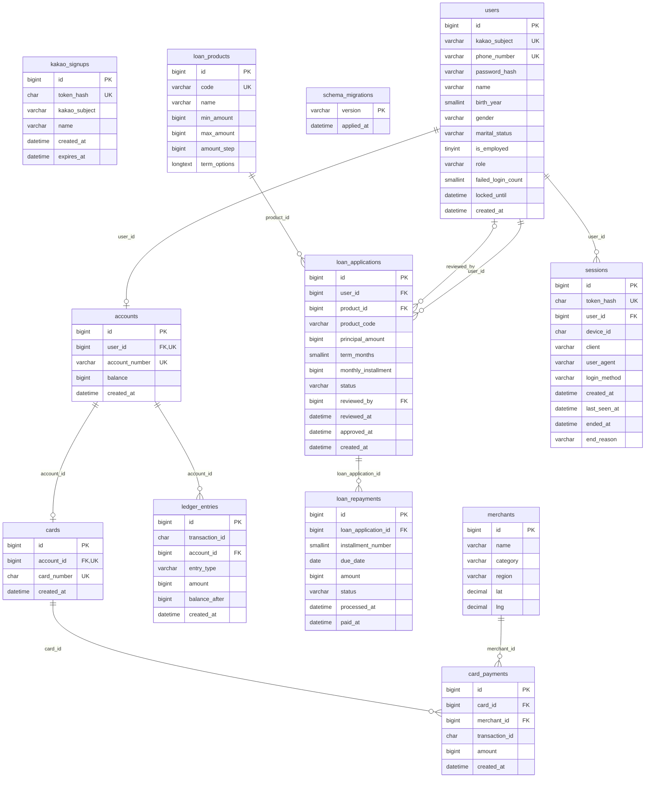

# 포도 뱅킹 시스템의 데이터 수집 & 관찰

---

> **뱅킹 서비스에서 발생하는 거래·이벤트·로그·메트릭을 수집하고, 데이터의 품질과 활용 가능성을 검증하는 프로젝트**
>
> 뱅킹 서비스를 직접 설계하면서 **데이터 발생 → 수집 → 저장 → 검증 → 관측**을 구현하는 프로젝트입니다.

## 0. 팀 소개

---

### 개주인과 퍼피

| 이름 | 역할 | GitHub |
|---|---|---|
| 목원주 | 추후 기재 | [wonju0516](https://github.com/wonju0516) |
| 박기령 | 추후 기재 | [wrtmm](https://github.com/wrtmm) |
| 이하영 | 추후 기재 | [coffeewoouuu](https://github.com/coffeewoouuu) |
| 조경호 | 추후 기재 | [naelonambul](https://github.com/naelonambul) |

## 1. 프로젝트 소개

---

은행 시스템을 모의 구현해 데이터 발생 환경을 만들고, 데이터를 수집·검증·관측할 수 있는 환경을 구축합니다. 
금융 거래가 정확하게 처리되고, 장애가 발생해도 거래 기록이 유실되지 않는 환경을 구축합니다. 

### 목표

1. **데이터 발생점 구축**: 회원, 입출금, 송금, 카드, 대출 기능을 갖춘 뱅킹 서비스 개발
2. **데이터 수집원**: 업무 DB, 이벤트 DB, 애플리케이션 로그, 시스템 메트릭
3. **데이터 품질 검증**: 누락, 중복, 정합성, 수집 지연 확인
4. **데이터 시각화**: Grafana를 통한 현황 모니터링

## 2. 주요 기능

---

### 2.1 뱅킹 서비스

| 기능 | 주요 내용 |
|---|---|
| 회원 관리 | 회원가입, 로그인, 로그아웃, 회원정보 관리 |
| 입출금 | 계좌 개설, 잔액 조회, 입금 및 출금, 거래 내역 조회 |
| 송금 | 계좌 간 송금, 수취인 관리, 송금 내역 조회 |
| 카드 | 카드 발급, 결제 및 취소, 이용 내역 조회 |
| 대출 | 대출 신청, 심사, 상환, 대출 내역 조회 |

### 2.2 데이터 수집 및 저장

- 사용자 행동 및 금융 거래 이벤트 수집
- MongoDB 기반 이벤트 데이터 저장
- Nginx 및 FastAPI 애플리케이션 로그 수집
- API 성능 및 서버 자원 메트릭 수집
- 데이터 수집 정상 여부 검증

### 2.3 모니터링 및 시각화

- CPU, 메모리 등 서버 자원 사용량
- Grafana 대시보드 구축

## 3. 시스템 아키텍처

---

## 4. erd

---

## 5. 데이터 수집 설계

---

### 5.1 데이터 수집원

| 수집원 | 데이터 종류 | 수집 내용 | 활용 목적 |
|---|---|---|---|
| MariaDB | 정형 데이터 | 회원, 계좌, 거래, 대출 정보 | 금융 거래 데이터 검증 |
| MongoDB | 반정형 데이터 | 사용자 행동 및 금융 이벤트 | 행동 패턴 및 이상거래 분석 |
| Nginx / FastAPI | 로그 데이터 | 요청, 응답, 오류 로그 | 장애 분석 및 요청 추적 |
| Prometheus | 시계열 데이터 | CPU, 메모리, 응답 시간, 요청 수 | 시스템 성능 모니터링 |

### 5.2 데이터 품질 검증

수집한 데이터가 믿을 수 있는지 **정합성, 중복, 동시성, 누락, 스키마 일관성, 수집 경로**의 여섯 가지로 나누어 DB 제약, 대사 배치, 테스트, 배포 검증 스크립트로 확인합니다.

| 기준 | 검증 방법 | 근거 |
|---|---|---|
| 정합성 (MariaDB) | DB 제약으로 잘못된 값을 저장 단계에서 거부합니다. 잔액 0 이상, 원장 금액 0 불가, 카드 결제 금액 0 초과, 계좌·카드·세션 등의 외래키, 전화번호·계좌번호·카드번호 고유값 등입니다. | `backend/migrations/0001_init.sql`, `backend/tests/api/test_schema.py` |
| 정합성 (잔액 ↔ 원장) | 일 마감 대사 배치(`python -m app.jobs.reconcile`)가 계좌마다 원장 `amount` 합계와 잔액이 같은지 한 번의 SELECT로 비교합니다. 불일치가 있으면 `reconciliation` 이벤트를 실패로 남기고 종료 코드 1로 끝납니다. | `backend/app/jobs/reconcile.py`, `backend/tests/api/test_jobs.py` |
| 중복 | MongoDB 이벤트 컬렉션(`events_bronze`, `card_payment_locations`)의 `event_id`에 고유 인덱스를 두어 같은 이벤트가 두 번 들어와도 하나만 남깁니다. 송금 이벤트가 로그와 MongoDB에 각각 한 번만 기록되는지 테스트합니다. | `backend/app/db/mongodb.py`, `backend/tests/api/test_events.py` |
| 동시성 (중복 거래 방지) | 동시 송금(양방향 교착 없음, 일일 한도 경쟁), 동시 출금·입금, 동시 가입·승인·대출 신청·로그인 잠금, 연결 풀 고갈 상황을 실제 MariaDB에서 테스트합니다. | `backend/tests/concurrency/` |
| 누락 | 이벤트는 DB 트랜잭션이 **커밋된 뒤에만** 기록하고, 롤백되면 쓰지 않습니다. 실패한 송금은 실패 이벤트만 남기는지 테스트합니다. | `backend/app/api/events/service.py`, `backend/tests/api/test_events.py` |
| 스키마 일관성 | 모든 이벤트가 `event_id`, `event_type`, `occurred_at`, `source`, `outcome`, `reason`, `request_id`, `properties` 필드를 같은 형태로 갖게 만듭니다. 이름·전화번호·계좌번호·카드번호·금액 같은 개인정보 키는 이벤트에 들어가지 못하게 막고(중첩 포함), 금액은 구간으로만 남깁니다. | `backend/app/api/events/service.py`, `backend/tests/unit/test_events.py` |
| 수집 경로 | 배포 후 실제 요청을 보내 Nginx·HAProxy·FastAPI 로그가 Alloy를 거쳐 Loki에서 조회되는지, 두 API 서버가 모두 요청을 받았는지, 요청 ID가 남는지 확인합니다. exporter 대상이 모두 정상(UP)인지, Prometheus·Grafana·Tempo가 응답하고 실제 추적이 조회되는지도 확인합니다. | `deploy/ansible/verify-proxy-logs.py`, `verify-exporters.py`, `verify-monitoring.py`, `verify-tracing.py` |

**장애 상황에서의 동작**

- MongoDB가 죽어 있어도 송금은 성공하고 앱은 시작됩니다. 이미 커밋된 돈 처리를 이벤트 저장 실패 때문에 오류로 바꾸지 않기 위해서입니다. 이벤트 저장에 실패하면 경고 로그만 남기고 거래는 그대로 성공 처리합니다. (`backend/tests/failure/test_mongo_down.py`)
- MariaDB가 내려가면 조회·로그인이, 연결 풀이 고갈되면 인증이 500이 아닌 503으로 응답합니다. (`backend/tests/failure/test_db_errors.py`)

### 5.3 수집 데이터 활용

## 6. 데이터 검증 및 시각화

---

**목표**

- 사용자 행동 이벤트 생성
- 금융 거래 이벤트 생성
- MongoDB 이벤트 저장
- 이벤트 중복 및 누락 검증

**검증**

- 거래 발생 시 이벤트 생성 여부
- 거래 ID와 이벤트 연결 여부
- 이벤트 스키마 일관성

## 6. 기술 스택

---

| 구분 | 기술 | 역할 |
|---|---|---|
| Backend | Python, FastAPI | 뱅킹 API 개발 |
| RDBMS | MariaDB (Master/Slave) | 업무 데이터 저장 및 복제 |
| NoSQL | MongoDB | 사용자 행동 및 금융 이벤트 저장 |
| Web Server | Nginx | 리버스 프록시 |
| Load Balancer | HAProxy | 백엔드 서버 부하 분산 |
| Metrics | Prometheus | 시스템 및 애플리케이션 메트릭 수집 |
| Log Collector | Grafana Alloy | 로그 수집 및 전달 |
| Log Storage | Grafana Loki | 로그 저장 및 조회 |
| Visualization | Grafana | 모니터링 대시보드 |
| Collaboration | Git, GitHub | 버전 관리 및 협업 |

## 11. 실행 및 재현 방법

---

## 12. 회고

---

